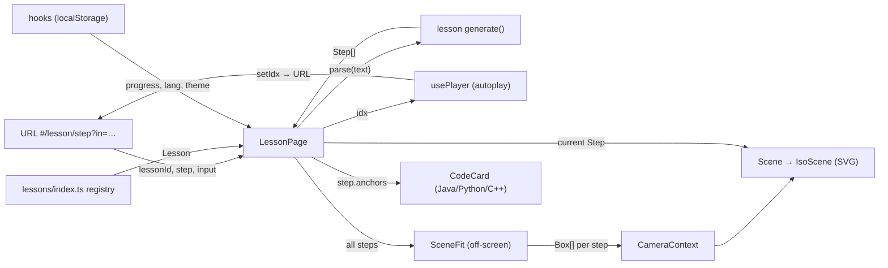

# Tracepoint

Tracepoint teaches data structures and algorithms through interactive lessons that you step through one operation at a time. Each step draws the structure as an isometric scene and highlights the lines that run, in Java, Python and C++. The name comes from the debugger tracepoint, a spot that records what happened.

## Features

- 26 lessons across five sections, browsed in an explorer tree under `DSA/`:
  - **Foundations:** Big-O by counting, arrays, strings, two pointers, sliding window, prefix sums.
  - **Linear structures:** stack, queue, deque, singly and doubly linked lists, fast and slow pointers.
  - **Hashing:** chaining, open addressing, frequency map and two-sum.
- Every folder has a guide (`README.md` in the explorer) and every lesson has a theory tab: a plain-language read of the idea before you watch it run.
- Every step comes with a short explanation, the one idea to take away, the call being made and its return value.
- The highlighted code follows you when you switch between Java, Python and C++.
- You can type your own values and re-run the lesson. Custom runs are encoded in the URL, so you can share them.
- The scene camera follows the drawing as it grows. It pans and zooms between steps.
- There is autoplay at 0.5×, 1× and 2×, plus keyboard controls and search (Ctrl+K).
- Light and dark themes. Your progress, language and theme are saved in the browser.

## Quick start

You need Node.js 18 or newer and npm.

```sh
npm install
npm run dev
```

Then open http://localhost:5173.

Keyboard controls in a lesson:

| Key | Action |
|---|---|
| Left / Right arrow | Previous / next step |
| Home / End | Jump to the first / last step |
| Space | Play or pause |
| R | Reset to step 1 |
| Ctrl+K | Search lessons |

## Scripts

| Command | What it does |
|---|---|
| `npm run dev` | Starts the Vite dev server with hot reload. |
| `npm run typecheck` | Runs `tsc --noEmit` in strict mode. |
| `npm test` | Runs the Vitest suite once (`vitest run`). |
| `npm run build` | Typechecks, then runs `vite build` into `dist/`. |
| `npm run preview` | Serves the built `dist/` locally. |

## Architecture

### Overview

Tracepoint is a static single-page app built with React 18, TypeScript and Vite. It has no backend.

Each lesson is a self-contained module:

- A pure `generate(input)` function turns an input into an array of step snapshots.
- A `Scene` component draws one snapshot as an isometric SVG.
- Three source files hold the code, with named anchor comments.

The app shell picks the lesson and the step from the URL and renders that one snapshot. Going back a step costs nothing, and you can link to any step.

### Diagram



### Modules

| Path | Responsibility |
|---|---|
| [`src/main.tsx`](src/main.tsx) | Entry point. Applies the saved theme, mounts `App` inside a `HashRouter`. |
| [`src/app/`](src/app) | Shell and pages. `App` holds the routes, `TopNav`, the course sidebar and drawer, `SearchDialog`, `GuidePage` (folder guides), `TheoryView` (the theory tab), `LessonPage` (layout and the step URL) and `CodeCard` (language tabs, highlighted lines). |
| [`src/engine/`](src/engine) | The lesson contract ([`types.ts`](src/engine/types.ts)), anchor parsing ([`anchors.ts`](src/engine/anchors.ts)) and the step player ([`usePlayer.ts`](src/engine/usePlayer.ts)). Nothing in here knows about any specific lesson. |
| [`src/lessons/`](src/lessons) | One folder per lesson, plus the registry ([`index.ts`](src/lessons/index.ts)), the shared input parser (`parseOps.ts`), test helpers (`testkit.ts`), the shared sort kit (`sortkit.ts` state, metrics and trace builder; `SortScene.tsx` the array plus an aux row) and the contract test that covers every lesson (`lessons.test.ts`). |
| [`src/iso/`](src/iso) | Isometric SVG primitives: the projection (`project.ts`), `IsoScene` (the camera and grid floor), blocks, pointers, and reusable pieces (`CellRow`, `LinkedNodes`, `Buckets`, `FrameStack` for call frames). Also `SceneFit` (measures each step) and `camera.ts` (pure framing math). |
| [`src/hooks/`](src/hooks) | `useKeyboard`, `useTheme`, `useProgress`, `useLang`, `useMedia`. Persisted values go in `localStorage` under `tracepoint-*`. |
| [`src/theory/`](src/theory) | The reading layer: one guide per section (`guides/`), the types, the text checker (`check.ts`) and the markup renderer. Each lesson's own theory lives in its `theory.ts`. |
| [`src/design/`](src/design) | `tokens.css` holds every colour as a token, with light and dark values. `ui.tsx` holds shared bits (`Icon`, `Badge`, `Kbd`, …). |
| [`src/curriculum.ts`](src/curriculum.ts) | The full course outline. Lessons that aren't built yet show as "soon". |
| [`src/app.css`](src/app.css) | Layout, including the narrow single-column mode below 1120px wide or 680px tall. |

How `lessons/` and `iso/` divide the work: a lesson's `Scene.tsx` decides *what* to draw from its own `state`. `iso/` decides *how* it looks and where the camera points.

Two more routes show the reading layer: `#/guide/:sectionId` renders a folder guide, and `#/:lessonId/learn` renders a lesson's theory tab. `#/` opens the Foundations guide.

### Data flow: opening `#/stack/5`

1. `HashRouter` matches `/:lessonId/:step` in [`App.tsx`](src/app/App.tsx) and renders `LessonPage`.
2. `LessonPage` looks up `stack` in `LESSON_BY_ID`. It reads the input from `?in=`, or uses the lesson's `defaultText` when there is none, and calls `lesson.parse(text)`.
3. `lesson.generate(input)` returns the full `Step[]`. Step 5 in the URL is index 4, because URL steps are 1-based.
4. `SceneFit` renders every step of the run off-screen once and reports a bounding `Box` for each step. `LessonPage` provides `boxes[idx]` through `CameraContext`.
5. The lesson's `Scene` draws the current step's `state` inside `IsoScene`. `follow()` in [`camera.ts`](src/iso/camera.ts) picks the next viewBox: it holds, pans or zooms. The view then eases there over 650ms, or jumps instantly when reduced motion is on.
6. `CodeCard` maps `step.anchors` to line numbers in the selected language through `linesFor()` and highlights those lines. It also shows `step.notes`, which hold the real values.
7. Pressing Right or Play calls `usePlayer`, which writes the next step into the URL, and the cycle repeats from step 1. `useProgress` records the visit.

### Key decisions

- **HashRouter instead of BrowserRouter.** Routes live after `#`, so any static host serves the app with no rewrite rules. The cost is less tidy URLs.
- **Steps are pure snapshots, not a replayed log.** `generate()` precomputes every step, so jumping, going back and deep links are free, and generators are easy to unit-test. The cost is memory, which is small at lesson-sized inputs.
- **Code highlights use named anchors, never line numbers.** One step drives three languages, and editing a code file doesn't break the highlights. `lessons.test.ts` checks that every anchor exists in all three languages.
- **Scenes are isometric SVG, not WebGL or canvas.** SVG is crisp at any zoom, is styled by the same CSS tokens as the rest of the UI, and can be measured with `getBBox()` for the camera. The cost is that very large scenes would be slow, which lessons don't need.
- **The camera frames each step but uses hysteresis.** Framing each step tightly made the scene "breathe" from step to step. `follow()` holds the shot, pans as little as possible, and zooms back in only when the drawing would grow by more than 1.25×. Don't simplify it back to plain per-step framing.
- **Every colour is a token.** Light and dark themes, scene state fills (`--st-*`) and syntax colours all come from [`tokens.css`](src/design/tokens.css). Dark values appear twice, in `prefers-color-scheme` and in `[data-theme="dark"]`, so keep the two in step.

## Adding a lesson

1. Add the lesson to [`src/curriculum.ts`](src/curriculum.ts) if it isn't there.
2. Create `src/lessons/<id>/` with these files ([`src/lessons/stack/`](src/lessons/stack) is a good template):
   - `generate.ts`: a pure function from input to `Step[]`. Start with a `problem` step and end with a `recap`.
   - `Scene.tsx`: draws one step's `state` using the pieces in `src/iso/`.
   - `code/Main.java`, `code/main.py`, `code/main.cpp`: tag the lines to highlight with `// @a name` or `# @a name`.
   - `theory.ts`: the lesson's theory, which is required. A new section also needs a guide in `src/theory/guides/`.
   - `index.ts`: `defineLesson({ … })`, which covers input parsing, presets, metrics, the memory view and the checklist.
   - `generate.test.ts`: covers the generator's steps and return values. `testkit.ts` has `run`, `at` and `rets` helpers.
3. Register the lesson in [`src/lessons/index.ts`](src/lessons/index.ts). It then appears in the course tree, and `lessons.test.ts` checks it automatically: default input parses, every anchor exists, the checklist is valid, and the lesson is in the curriculum.
4. Run `npm run typecheck` and `npm test`.

Design rules for scenes and UI are in [CLAUDE.md](CLAUDE.md#design-rules). In short: a debugger look in warm graphite (espresso-tinted neutrals, one ember marker, JetBrains Mono throughout), a step timeline that fills up to the playhead, check badges and progress rings for finished and started lessons, colour only for state, text contrast of at least 4.5:1, and respect for reduced motion.

## Deployment

The site deploys to Vercel. Use framework preset **Vite**, build command `npm run build`, and output directory `dist`. Routing is hash-based, so the site needs no rewrites or `vercel.json`. Every merge to `main` deploys to production.
